# 모바일 디자인 기준

iOS(SwiftUI)와 Android(Compose)를 따로 만들면서 두 앱이 같은 서비스로 보이게 하는 최소 기준이다. 두 앱은 같은 **역할 이름, 문구, 화면 상태**를 쓰고, 생김새는 각 플랫폼의 시스템 스타일을 따른다. 공유 UI 코드, 토큰 생성기, Figma, 디자인 시스템 라이브러리는 두지 않는다. 브랜드 색은 아직 정하지 않았다. (앞의 세 문장 중 생김새·토큰 생성기·디자인 시스템·브랜드 색은 superseded by [ADR-0014](../adr/0014-unified-design-system.md): 두 앱이 토큰 JSON에서 생성한 같은 테마를 쓴다. 역할 이름·문구·화면 상태는 그대로다.) 아래 값은 모두 임시이며 각 플랫폼의 테마 파일 하나에서 바꾼다.

| 플랫폼 | 역할을 연결한 파일 |
| --- | --- |
| iOS | `apps/ios/Nonanona/Design/Theme.swift` |
| Android | `apps/android/app/src/main/java/app/nonanona/design/Theme.kt`, `StatusLabel.kt` |

## 맞추는 것과 플랫폼에 맡기는 것

| 맞춘다 | 플랫폼에 맡긴다 |
| --- | --- |
| 역할 이름(색·글자·간격·상태 라벨) | 탐색: iOS `NavigationStack`, Android Navigation 3 + 시스템 뒤로 가기(예측 뒤로 포함) |
| 한국어 문구와 말투(해요체, 짧은 문장) | 시트: iOS `.sheet`(detents), Android `ModalBottomSheet` |
| 화면과 상태의 종류, 상태를 바꾸는 동작 | 사진 고르기: iOS `PhotosPicker`, Android 시스템 사진 선택기(`PickMultipleVisualMedia`), 둘 다 권한 요청 없음 |
| 상태는 글자 라벨로 표시(색은 보조) | 공유로 받기: iOS 공유 확장(시트 안에서 "초안에 담기"), Android 공유 대상 Activity(바로 담고 스낵바) |
| 간격 값 | 제목: iOS 큰 제목, Android 상단 앱 바 / 주 동작: iOS 하단 막대, Android 확장 FAB |
| 글자 크기는 시스템 설정을 따름 | 로그인 버튼 모양(아래 "로그인 버튼") |
| 창 크기별 배치 규칙과 읽기 폭 640(아래 "창 크기와 접기") | 목록·상세: iOS `NavigationSplitView`, Android `ListDetailSceneStrategy` / 두 칸 기준: iOS 가로 regular, Android 840dp |

## 색 역할 (임시 중립 팔레트)

> 임시 중립 팔레트는 superseded by [ADR-0014](../adr/0014-unified-design-system.md)(두 앱 공통 토큰, "맑은 하늘"). 앱에 반영하기 전까지 아래 값이 지금 코드의 값이다. 역할 이름은 그대로 쓴다.

브랜드 색이 없으므로 무채색만 쓴다. Android는 동적 색(Material You)을 끈다. 두 앱의 화면을 같은 기준으로 비교하기 위해서다.

| 역할 | 뜻 | SwiftUI | Compose Material 3 |
| --- | --- | --- | --- |
| background | 화면 바탕 | 시스템 그룹 배경(목록 기본값) | `background`/`surface` 라이트 #F9F9F9, 다크 #131313 |
| container | 카드·목록 행 | 목록 셀 배경 | `surfaceContainerHigh` |
| content | 본문 글자 | `.primary` | `onSurface` |
| contentSecondary | 보조 글자 | `.secondary` | `onSurfaceVariant` |
| accent | 주 동작·강조, 앱 tint | `.primary`(라이트 검정, 다크 흰색) | `primary` 라이트 #303030, 다크 #E2E2E2 |
| onAccent | accent 위 글자 | `systemBackground` | `onPrimary` |
| error | 실패 문구 | `.red` | `error`(M3 기본값) |

## 글자 역할

크기를 직접 정하지 않는다. iOS는 Dynamic Type 텍스트 스타일, Android는 M3 기본 타입 스케일(sp)을 써서 시스템 글자 크기 설정을 그대로 따른다.

| 역할 | 쓰는 곳 | SwiftUI | Compose M3 |
| --- | --- | --- | --- |
| screenTitle | 화면 제목 | 내비게이션 큰 제목 / inline | `TopAppBar` 제목 |
| heading | 화면 안 큰 문장(초대 화면) | `.title2.bold()` | `headlineSmall` |
| sectionTitle | 섹션 머리말, 카드 제목 | `.headline` | `titleMedium` |
| body | 본문 | `.body` | `bodyLarge` |
| supporting | 설명·날짜 | `.subheadline` | `bodyMedium` |
| status | 상태 라벨 | `.caption.weight(.semibold)` | `labelMedium` |

한국어 줄바꿈: iOS는 기본으로 어절 단위로 끊는다. Android는 글자 로캘을 `ko-KR`로 두고 `LineBreak.WordBreak.Phrase`를 써서 같은 결과를 낸다(API 33 이상).

## 간격 역할

`xs 4`, `s 8`, `m 16`(화면 좌우 여백, 카드 안 여백), `l 24`, `xl 32`. 단위는 pt와 dp로 같은 숫자다. 목록 행 높이와 안쪽 여백은 시스템 목록 기본값을 따른다.

## 상태 라벨

상태는 항상 글자로 보여 준다. 색만으로 구분하지 않는다.

| 역할 | 예 | SwiftUI | Compose M3 |
| --- | --- | --- | --- |
| neutral | 기기에만 저장됨, 로그인 안 됨, 방장, 나 | `.secondary` / `tertiarySystemFill` | `onSurfaceVariant` / `surfaceContainerHighest` |
| attention | 초대 대기 중 | `systemBackground` / `.primary`(반전) | `onPrimary` / `primary` |
| positive | 로그인됨 · 이름, 참여함 | `.primary` / `secondarySystemFill` | `onSecondaryContainer` / `secondaryContainer` |
| error | (실패 상태 라벨용 예약) | `.red` / 옅은 빨강 | `onErrorContainer` / `errorContainer` |

## 화면과 상태

| 화면 | 상태 | 주요 문구 |
| --- | --- | --- |
| 홈 | 초안 없음 / 초안 있음 / 초대 대기 카드 / 로그인 안 됨·로그인됨 | 노나노나 · 영수증 초안 · 아직 초안이 없어요 · 사진 N장 · 기기에만 저장됨 · 사진 고르기 |
| 공유로 받기 | 담기 전 / 담는 중 / 실패 | 영수증 초안에 담기 · 사진 N장을 이 기기의 초안에 저장해요. 로그인하지 않아도 돼요. · 사진 N장을 초안에 담았어요 |
| 초안 | 사진 목록 | 초안 · 로그인하지 않아도 이 기기에 보관돼요. |
| 초대 | 로그인 필요 / 참여 가능 / 참여 중 / 실패 | 여행방 초대 · 여행방에 초대받았어요 · 로그인하고 참여하기 · 참여하기 · 참여하지 못했어요. 다시 시도해 주세요. |
| 로그인 시트 | 고르기 / 로그인 중 / 실패 / 사용 불가 | 로그인 · 여행방을 만들거나 초대를 수락하려면 로그인해요. · 지금은 로그인할 수 없어요. |
| 여행방 | 참여함 | 일행 · 방장 · 나 · 영수증 초안 N장은 아직 이 기기에만 있어요. |
| 목록 옆 안내(넓은 창) | 아무것도 고르지 않음 | 초안을 골라 주세요 · 목록에서 초안을 고르면 여기에 보여요. |
| 영수증 목록(초안) | 읽는 중·대기 / 다 읽음 / 읽지 못함 있음 / 다 확인하고 돌아옴 | 읽음 N/M · 확인 K/M · 읽는 중 2 · 대기 4 · 확인 필요 3 · 읽지 못함 1 · 확인함 0(0이 아닌 것만) · 읽지 못한 사진 N장이 있어요. 다시 읽거나 값을 직접 입력해 주세요. · 사진 N 열기 · 확인할 영수증 검토 (N) · 지금 확인할 수 있는 영수증을 모두 확인했어요. 남은 것: 읽지 못함 N장 |
| 영수증 목록 행 | 대기 중 / 읽는 중(다시 읽는 중이에요.) / 확인 필요(가게 · 날짜 · 금액 · 가림 N곳) / 읽지 못함(다시 읽기 · 직접 입력) / 확인함(직접 입력(사진은 올리지 않아요)) | 행을 누르면 검토 화면 |
| 영수증 검토 | 확인 필요 / 읽지 못함 / 대기·읽는 중 / 확인함 / 입력 저장 실패(입력을 기기에 저장하지 못했어요. 화면의 입력은 그대로예요. · 다시 저장) / 확인 저장 실패(확인을 저장하지 못했어요. 아직 확인되지 않았고 입력은 그대로예요. 다시 눌러 주세요.) | 사진 N · 확인 K/M · 원본 · 가린 사본 · 가림 N곳 · 자동으로 찾지 못한 정보가 있을 수 있어요… · 자동 제안 · 가림 영역 더하기 · 직접 더한 영역 1 · 위에서 47–53% · 위로·아래로·넓게·좁게·삭제 · 가게 · 날짜(예: 2026-11-03 또는 20261103) · 금액 · 통화 · 이 사진만 다시 읽기 · 직접 입력 · 확인하면 가린 사본을 만들어요. 원본은 이 기기에만 남아요. · 확인하고 다음 |

debug 빌드의 테스트 로그인은 시트에 **테스트 로그인 · 실제 계정에 연결하지 않아요** 라벨을 붙인다. 이 문구와 테스트 구현체는 release 빌드에 들어가지 않는다.

## 로그인 버튼

- iOS: Apple(검정 바탕 흰 글자, 다크에서는 반전, Apple 로고 SF Symbol)과 Google(테두리 버튼). Android: Google만(테두리 버튼). [ADR-0002](../adr/0002-authentication-and-device-transfer.md)의 제공자 구성이다.
- 실제 로그인을 연결할 때 iOS는 `SignInWithAppleButton`, Google은 브랜드 지침의 공식 버튼(로고 포함)으로 바꾼다. 지금 버튼은 같은 자리와 문구만 맞춘 임시 버튼이다.

## 창 크기와 접기

배치는 기기 모델이나 세로 고정이 아니라 **지금 창**의 크기 종류·크기, 안전 영역, 시스템이 알려 주는 접힘·가림 영역으로 정한다([ADR-0004](../adr/0004-adaptive-layout.md)). 화면의 생김새(문구, 역할, 상태 라벨)는 그대로이고 놓이는 자리만 바뀐다. 이 절은 배치의 바탕만 정한다. 영수증 검토·가림 편집 화면의 시각 흐름(A/B)은 여기서 고르지 않는다.

### 크기별 배치

| 창 | iOS | Android | 배치 |
| --- | --- | --- | --- |
| 좁은 창: 폰 세로, iPhone Duo 바깥 화면, 폴더블 바깥 화면, 분할 화면의 좁은 쪽 | 가로 compact | 폭 600dp 미만(compact) | 한 화면씩 쌓는다. 시스템 뒤로 가기·스와이프 |
| 낮은 창: 폰 가로, 큰 글자 | 세로 compact | 높이 480dp 미만 | 같은 한 화면(iOS Pro Max 가로는 아래 넓은 창). 모든 화면·시트는 스크롤로 마지막 버튼까지 닿는다 |
| 중간 폭: 600~840dp | regular면 넓은 창 | 한 칸(Material 기본) | 한 칸, 글 위주 내용은 읽기 폭 |
| 넓은 창: iPhone Duo 안쪽 화면, Pro Max 가로, 펼친 폴더블(840dp 이상) | 가로 regular | 폭 840dp 이상(expanded) | 목록(홈) 옆에 고른 화면(초안·초대·여행방). 아무것도 안 골랐으면 "초안을 골라 주세요" 안내 |
| 반쯤 접은 폴더블(책 자세) | 시스템 분할 보기가 접힘에 맞춰 열 폭을 정한다 | 세로 separating hinge가 있으면 폭과 상관없이 두 칸, 두 칸은 접힘 양쪽 | 내용·버튼은 접힘 위에 놓이지 않는다 |

- 목록·상세: iOS `NavigationSplitView`(`.balanced`, 목록 숨기기 버튼 없음), Android Navigation 3 `ListDetailSceneStrategy`(material3-adaptive). 상세는 넓은 창에서 뒤로 가기 화살표 없이 목록 옆에 있고, 고른 초안은 목록에서 고른 상태(iOS 선택 강조, Android 행 바탕색)로 보인다. 스낵바는 맨 위 화면 하나만 띄운다.
- 읽기 폭: 글 위주 목록·화면·시트는 넓은 창에서 **640**(pt·dp, M3 바텀 시트 최대 폭과 같음)보다 넓어지지 않고 가운데에 둔다. 좁은 창에서는 아무것도 바꾸지 않는다.
- 접힘·가림: 안전 영역은 시스템 컨테이너가 지킨다. iOS는 목록·시트의 스크롤 여백(`adaptiveContentMargins`)이 `ReservedRegion`(division) 세로 접힘을 피해 넓은 쪽에 내용을 둔다(iOS 27.1 이상, 시스템 분할 보기 안에서는 보통 0). 활성 division만 피한다. iPhone Duo를 완전히 펼치면 접힘 division은 비활성이라 피하지 않는다(Apple `ReservedRegion` 문서). Android는 시트·대화상자를 hinge 넓은 쪽에 옮긴다. 두 앱이 같은 규칙(`ContentMargins.fitting`)을 쓴다.
- 막대: iPhone Duo 바깥 화면에서는 시스템이 상태 막대·도구 막대·뒤로 버튼을 옆(세로)에 둔다. 글자만 있는 하단 동작 "사진 고르기"는 시스템 규칙대로 가로 막대에 남는다(아이콘으로 바꾸는 것은 디자인 결정으로 남긴다).
- 창(시트·확인): 로그인 시트와 올릴 곳·장수 최종 확인은 화면 맨 위에서 한 번만 띄운다. iOS 최종 확인은 가운데 알림이다(Android AlertDialog와 같음). 예전의 행 안 확인 시트는 넓은 창에서 팝오버가 되어, 열린 채 회전하면 다시 뜨지 못하고 멈췄다.

### 바뀌어도 남는 것

창 크기 변경, 접기·펴기, 회전, 분할 화면, Android의 Activity 다시 만들기를 지나도 다음이 그대로다. 모두 화면이 아니라 모델(iOS `AppModel`, Android `AppViewModel`)에 있다.

| 상태 | 어디에 | 확인 |
| --- | --- | --- |
| 지금 화면(고른 초안은 안정 ID) | iOS `selection: Route?`, Android `backStack: [Route]` | 두 E2E, iOS 단위 테스트(분할 보기 접기·펴기) |
| 처리 상태와 처리기 | 초안 ID별 처리기·manifest | 읽는 중 회전·접기 뒤 사진별 시도 횟수 1(중복 OCR 없음), 장면 다시 활성화 5번에도 OCR 2번(단위 테스트) |
| 최종 확인의 올릴 곳·장수 | `uploadConfirmation`(초안 ID, 여행방 ID·이름, 장수) | 열린 채 회전·접기·펴기 뒤 같은 문장, 한 번만 올림. 그사이 올릴 곳이 바뀌면 예전 확인으로는 올리지 않음(단위 테스트) |
| 로그인 시트·참여 상태 | `login`, `join` | 반쯤 접은 채·가로 큰 글자에서 시트 사용 |
| 고른 영수증(검토 화면) | iOS `reviewing: ReviewTarget?`(초안 ID + 사진 ID), Android `backStack`의 `Route.Receipt` | iOS 단위 테스트(분할 보기 접기·펴기 중 검토), 두 검토 E2E(회전·펴기·접기·큰 글자) |
| 아직 확인하지 않은 입력(값·가림) | 모델 + 디스크 `reviews/<사진>.json`(고칠 때마다 원자적으로 씀, 확인하면 지움) | 앱 SIGKILL 뒤 같은 값, "이 사진만 다시 읽기"를 지나도 같은 값(두 E2E, 두 플랫폼 단위 테스트) |
| 원본·가린 사본 보기, 미리보기 | 모델(`showsMaskedPreview`, 미리보기는 가림이 바뀌면 버림) | 같은 E2E |

### 영수증 목록과 검토(목록 먼저)

결정과 이유는 [ADR-0005](../adr/0005-receipt-review-and-mask-correction.md). 초안 화면이 영수증 목록(검토 대기열)이고, 검토 화면은 목록·상세의 **상세 쪽**에 붙는다.

- **목록이 먼저**: 받은 영수증을 모두 사진 번호 순서로 보이고, 위에 읽음·확인 수와 상태별 개수(읽는 중과 대기를 나눔), 읽지 못한 사진 안내("사진 N 열기"), 주 동작 "확인할 영수증 검토 (N)"을 둔다. 행의 상태 라벨은 글자다. 읽지 못한 행에는 "다시 읽기"와 "직접 입력"이 있다.
- **검토 화면**: 위에서부터 상태·진행, 원본/가린 사본 전환(원본에는 가릴 곳을 반투명 띠로 겹쳐 보임), 가림(경고 → OCR 줄 스위치 → 직접 더한 영역 → 더하기), 값(가게·날짜·금액·통화), 하단 고정 막대(왜 누를 수 없는지 또는 누르면 무엇이 생기는지 한 줄 + "확인하고 다음"). 읽지 못한 사진은 가림 대신 "이 사진만 다시 읽기"와 직접 입력이 있다. 확인한 사진은 확인한 사본과 값만 보인다.
- **배치**: iOS는 분할 보기 상세 열 안에서 초안 위에 검토를 쌓는다(넓은 창: 홈 목록 | 초안→검토, 좁은 창: 한 화면씩). Android는 세 번째 칸이라 두 칸이면 **영수증 목록 | 검토**, 한 칸이면 검토만 보인다. 검토 화면은 한 열이라 접힘 피하기는 시스템 컨테이너(iOS 열, Android 두 칸이 hinge 양쪽)에 맡긴다. 읽기 폭 640 규칙은 같다.
- **접근성**: 가림 조작은 모두 이름 있는 조작(줄 스위치는 OCR 글자가 이름, 영역 버튼은 "영역 1 아래로"처럼)이고, 영역 글자는 화면 읽기 조절(iOS `accessibilityAdjustableAction`, Android 사용자 지정 동작 위로·아래로)로도 옮긴다. 가린 사본 이미지는 "가린 사본 미리보기, 가림 N곳…"만 읽히고 가린 글자는 읽히지 않는다. 조작 높이는 44pt·48dp 이상, 글자는 시스템 크기를 따른다.

#### 확인한 것 (2026-11-23, 가상 영수증 10장)

두 플랫폼 검토 E2E(`ios:e2e-review` iPhone 18 Pro Max 시뮬레이터, `android:e2e-review` Pixel 9 Pro Fold 프로필 에뮬레이터)가 같은 순서로 통과했다. 단계별 결과와 서버 검사는 [apps/README](../../apps/README.md#영수증-검토목록-먼저).

| | iOS | Android |
| --- | --- | --- |
| 목록(다 읽은 뒤) | 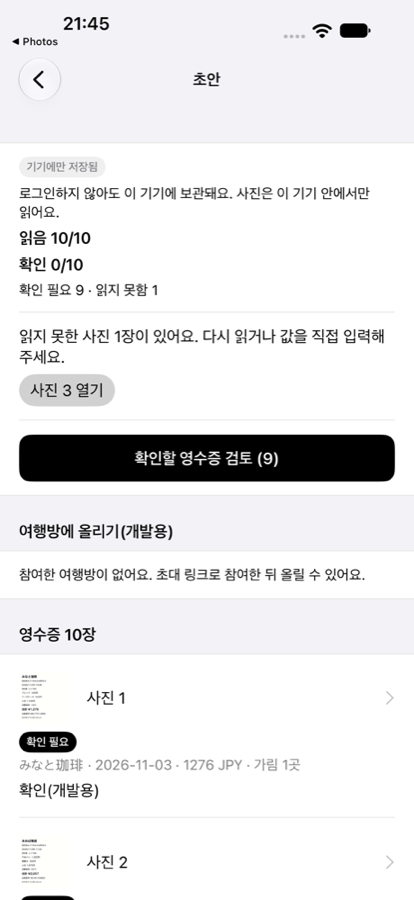 | 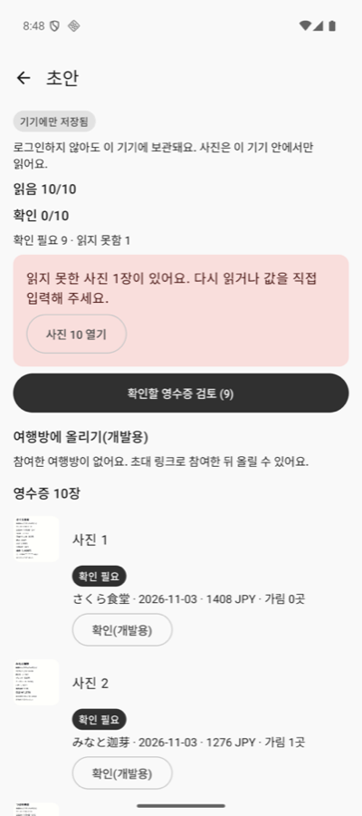 |
| 놓친 가림을 줄 + 영역으로 고침 | 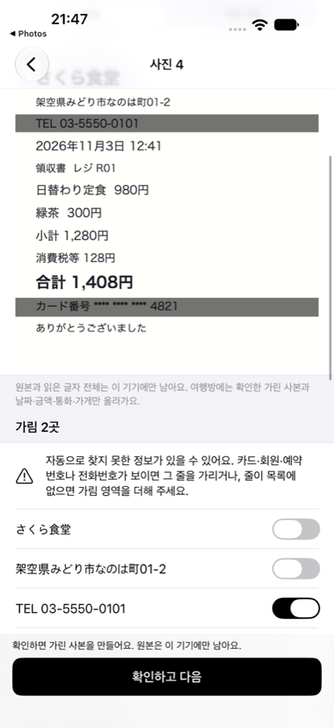 | 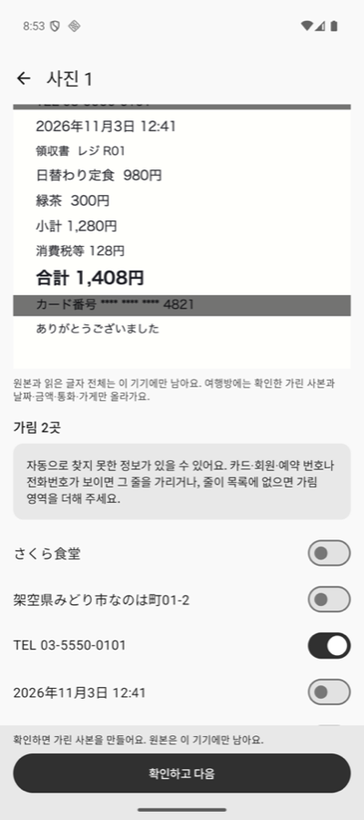 |
| 가린 사본 미리보기 | 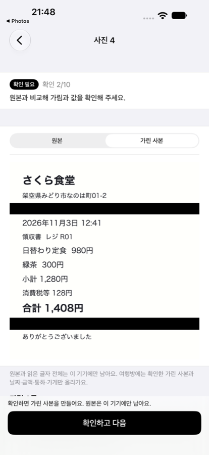 | 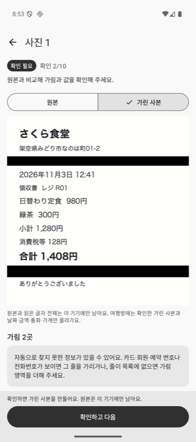 |
| 넓은 창(iOS 가로: 홈 옆 검토, Android 펼침: 영수증 목록 옆 검토) | 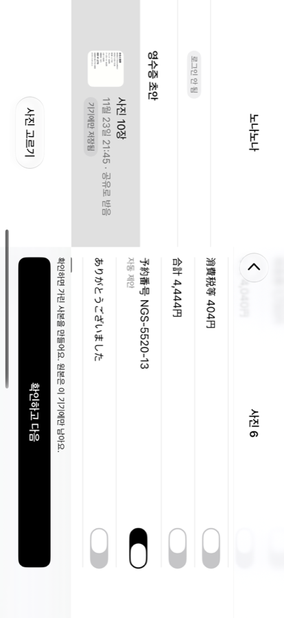 | 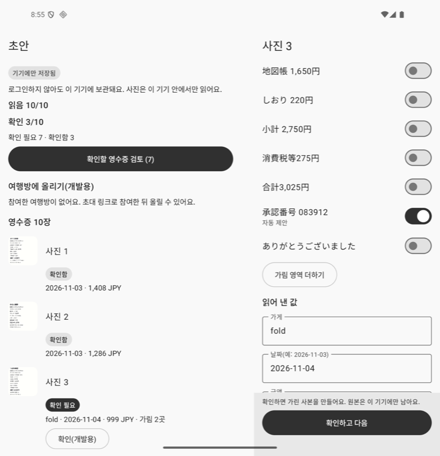 |
| 가장 큰 글자(iOS `accessibility-extra-extra-extra-large`, Android `font_scale 2.0`) | 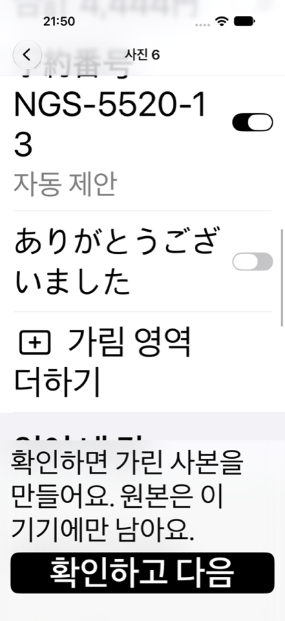 | 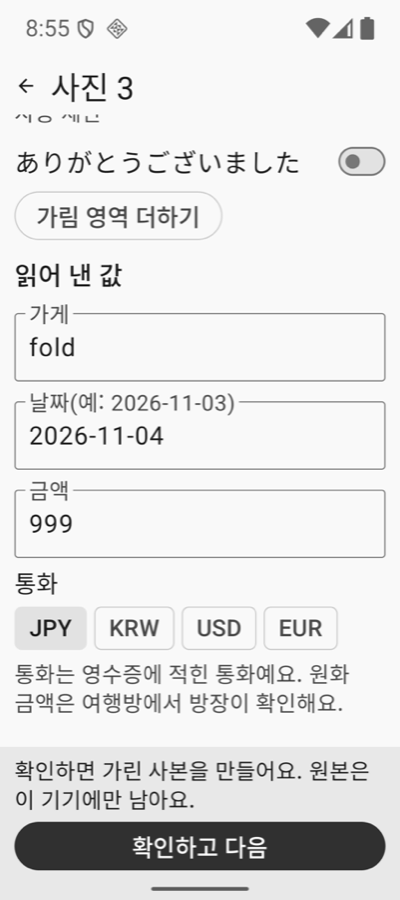 |

- 가장 큰 글자에서 하단 확인 막대(안내 한 줄 + 버튼)가 화면의 약 1/3을 차지한다. 목록은 스크롤로 모두 닿지만, 막대 높이를 줄일지(안내를 접기 등)는 디자인 결정으로 남긴다.
- 확인하지 않은 것: VoiceOver·TalkBack 실제 읽기 순서와 조절 동작, 다크 모드의 검토 화면, iPhone Duo 자세·반쯤 접기에서의 검토 화면, 사진 확대.

### 확인한 기기와 구성 (2026-11-21, iPhone Duo 자세는 2026-11-23, 가상 자료)

| 구성 | iOS (`mise run ios:e2e-adaptive`, Duo 자세는 `mise run ios:e2e-posture`) | Android (`mise run android:e2e-adaptive`) |
| --- | --- | --- |
| 좁은 창(바깥 화면) | iPhone Duo 시뮬레이터 바깥 화면(466×678pt, 세로·가로) | Pixel 9 Pro Fold 프로필 에뮬레이터를 실제로 접어(`emu fold`) 바깥 화면(1080×2424px) |
| 넓은 창 | iPhone 18 Pro Max 가로(가로 regular, 목록 옆 초안), iPhone Duo 시뮬레이터 안쪽 화면(951×669pt, 가로 regular, 목록 옆 초안) | 펼친 안쪽 화면(2076×2152px, 약 852dp) |
| 접기·펴기 이벤트 | iPhone Duo 시뮬레이터에서 Device Hub 자세 버튼으로 읽는 중 folded → book → flat → folded(같은 초안·읽음 0/2, 사진별 시도 1번), 최종 확인을 연 채 같은 순서(같은 문장, 한 번만 올림) | 읽는 중 펼침 → 접기 → 펴기 → 반쯤 접기(`emu posture 2`) |
| 반쯤 접기 | book(두 번째 버튼, 시스템 hinge `partiallyOpen` 133.8°): 시스템이 활성 세로 division 455.5–495.5를 알리고 분할 보기 열(목록 0–455.7, 초안 495.7–)과 최종 확인 알림(97.7–371.7)을 그 밖에 둔다. flat(세 번째 버튼, `fullyOpen` 180°): division이 비활성이라 열(목록 0–320)·가운데 알림이 그 자리에 걸치는 것이 정상(Apple 문서) | 두 칸이 hinge(x=1038px) 양쪽(목록 0–1038, 상세 1097–2076), 로그인 시트·최종 확인이 hinge 한쪽 |
| 낮은 창·회전 | Duo 바깥 화면·Pro Max·18 Pro 세로↔가로(읽는 중, 최종 확인을 연 채) | 안쪽 화면 가로 |
| 큰 글자 | `accessibility-extra-large` + 가로 | `font_scale 2.0` + 가로 |
| 분할·크기 바꾸기 | 단위 테스트: 실제 창에 띄운 분할 보기를 669×951 regular → 466×678 compact → 951×669 regular → 320×951 compact로 바꿈 | `wm size 1300x1000`(533×410dp, compact 폭·높이) |
| 스크롤·키보드 | 가로 큰 글자에서 초안 마지막 행·로그인 시트 버튼까지 스크롤 | 같음 |

| | iOS | Android |
| --- | --- | --- |
| 넓은 창 |  |  |
| 좁은 창(바깥 화면). iOS는 최종 확인, 세로 뒤로 버튼 | 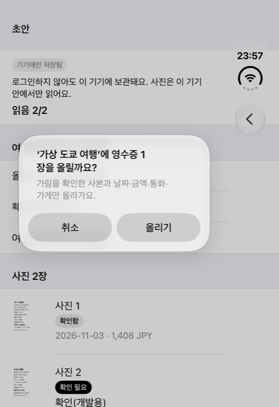 |  |
| 반쯤 접기 + 최종 확인 | (사진은 `ios:e2e-posture` 증거 폴더에 남김, 커밋하지 않음) | 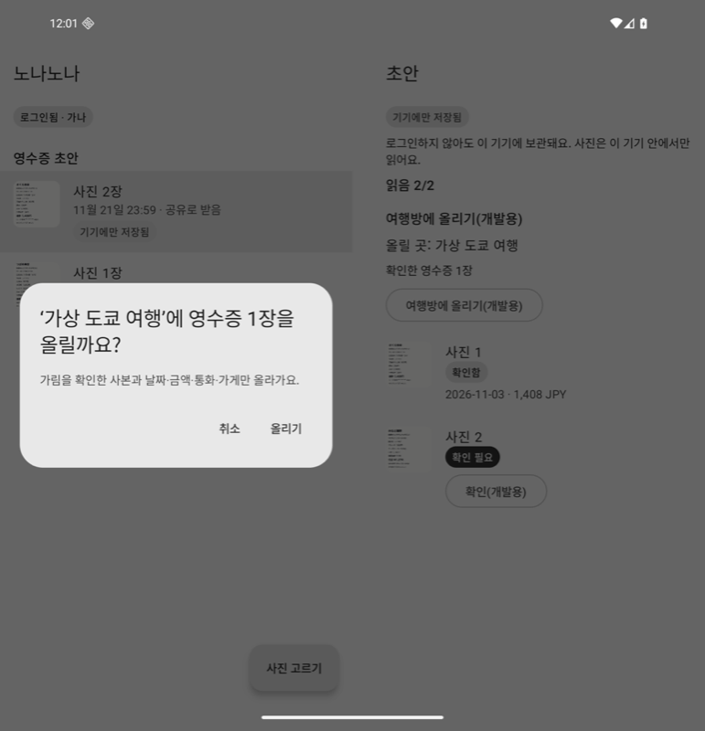 |
| 큰 글자 + 가로 | 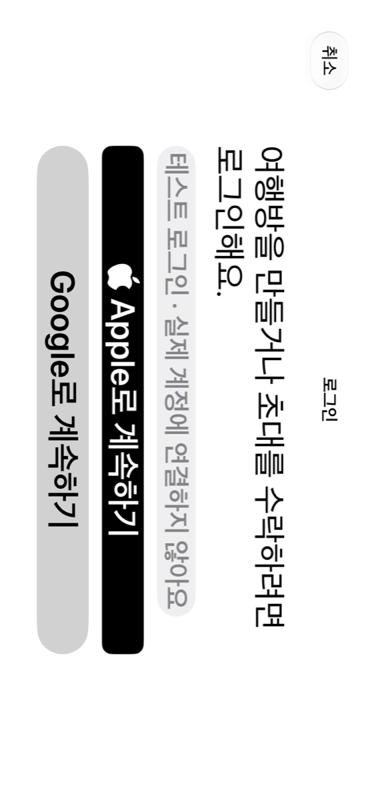 | 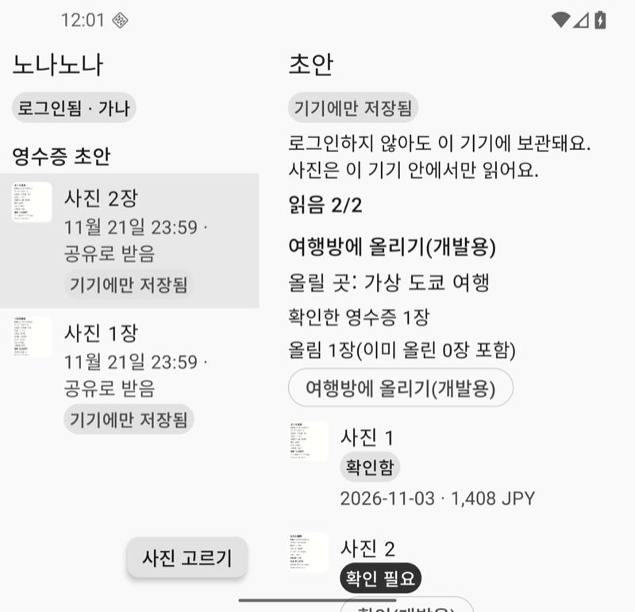 |

**iPhone Duo 자세**: 자세는 Xcode Device Hub의 버튼으로만 바뀐다(`simctl`·XCTest에는 자세 명령이 없다). `ios:e2e-posture`가 Orca Computer Use로 그 버튼을 누른다. 2026-11-22에는 GUI 자동화가 손쉬운 사용 권한 문제로 Device Hub에 닿지 못했고, 2026-11-23에 권한이 맞춰진 뒤 시뮬레이터에서 확인했다. 자세 이름, 좌표, division 로그는 [apps/README](../../apps/README.md#iphone-duo-자세-2026-11-23-시뮬레이터)에 있다.

**증거 공백**: iPhone Duo 결과는 시뮬레이터다. 실제 하드웨어의 접힘 각도·hinge, 실기기, 태블릿, 데스크톱 창(ChromeOS·Mac의 iPhone 앱), Android 실제 분할 화면(두 앱 동시 실행)은 확인하지 않았다.

## 확인한 것 (2026-11-21, 가상 자료)

핵심 화면은 **로그인 전 홈(초안 1장 + 초대 대기)**이다. 아래 화면은 두 앱의 E2E 실행 중 같은 상태에서 찍었다(iPhone 18 Pro 시뮬레이터 iOS 27.2, Android 에뮬레이터 API 36).

| | iOS | Android |
| --- | --- | --- |
| 라이트 |  |  |
| 다크 |  |  |
| 큰 글자 |  | 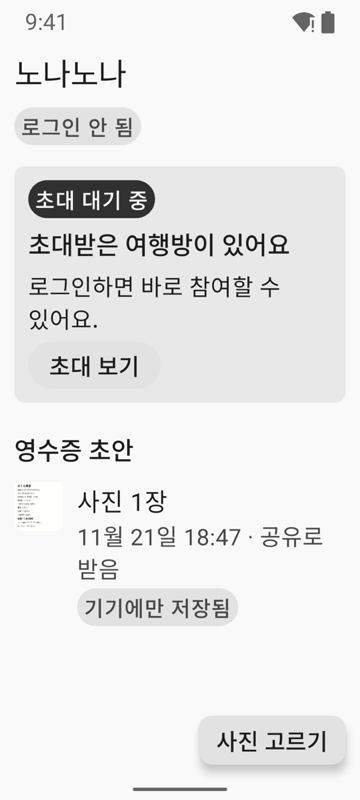 |
| 로그인 시트(debug) |  | 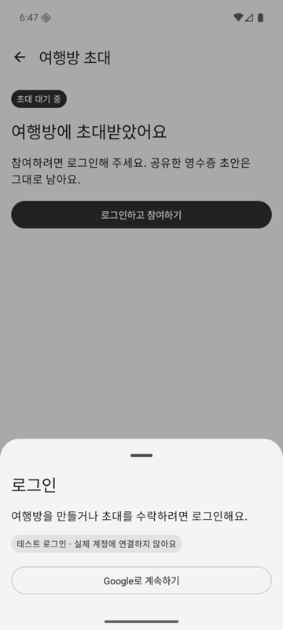 |
| 로그인 시트(release) |  |  |
| 여행방 | 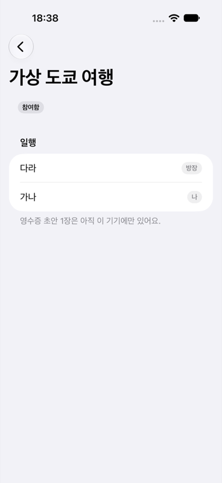 | 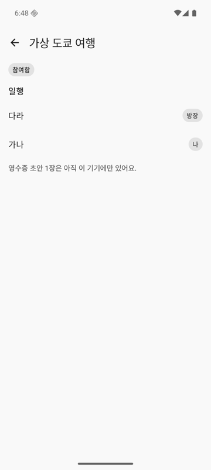 |

- 다크: 모든 글자·라벨이 바탕과 구분된다. 초대 대기 라벨은 반전 색, 주 동작은 라이트에서 검정, 다크에서 흰색이다. 하드코딩한 흰색·검정 글자는 없다.
- 큰 글자(iOS `accessibility-large`, Android `font_scale 2.0`): 글자가 잘리거나 겹치지 않고 줄이 늘어난다. 처음에 Android 초안 행의 상태 라벨을 행 끝에 두었더니 날짜가 좁은 칸에서 음절 단위로 끊겨, 라벨을 날짜 아래로 옮겨 iOS와 같은 배치로 맞췄다. 한국어 어절 줄바꿈도 이때 고쳤다.
- Android는 다크 전환과 글자 크기 변경(설정 변경으로 Activity를 다시 만듦) 뒤에도 같은 화면과 상태가 남는 것을 E2E에서 확인했다.
- 확인하지 않은 것: VoiceOver/TalkBack 읽기 순서, 명암비 수치 측정, 태블릿, 오른쪽에서 왼쪽 언어. 가로 화면·접히는 기기는 위 "창 크기와 접기"에서 확인했다.

## 참고한 플랫폼 문서

- Apple HIG: [Typography](https://developer.apple.com/design/human-interface-guidelines/typography), [Color](https://developer.apple.com/design/human-interface-guidelines/color), [Dark Mode](https://developer.apple.com/design/human-interface-guidelines/dark-mode), [Sheets](https://developer.apple.com/design/human-interface-guidelines/sheets), [Sign in with Apple](https://developer.apple.com/design/human-interface-guidelines/sign-in-with-apple)
- Material 3: [Color roles](https://m3.material.io/styles/color/roles), [Typography](https://m3.material.io/styles/typography/applying-type), [Bottom sheets](https://m3.material.io/components/bottom-sheets/guidelines)
- Android: [Photo picker](https://developer.android.com/training/data-storage/shared/photopicker), [Receive data from other apps](https://developer.android.com/training/sharing/receive), [Font scaling](https://developer.android.com/guide/topics/resources/runtime-changes)
- Google: [Sign in with Google branding guidelines](https://developers.google.com/identity/branding-guidelines)
- 창 크기와 접기(확인일 2026-11-21, 접힘 division·hinge는 2026-11-23): Apple [Designing for iPhone Duo](https://developer.apple.com/design/human-interface-guidelines/designing-for-iphone-duo), [Preparing your app for iPhone Duo](https://developer.apple.com/documentation/technologyoverviews/preparing-your-app-for-iphone-duo), [ReservedRegion](https://developer.apple.com/documentation/swiftui/reservedregion)(division은 반쯤 열렸을 때만 활성), [UIHinge](https://developer.apple.com/documentation/uikit/uihinge)(배치에 쓰지 않음), Android [Use window size classes](https://developer.android.com/develop/ui/compose/layouts/adaptive/use-window-size-classes). API는 Xcode 27.2 SDK의 SwiftUI 인터페이스와 material3-adaptive 1.3.0 소스에서 확인했다.
