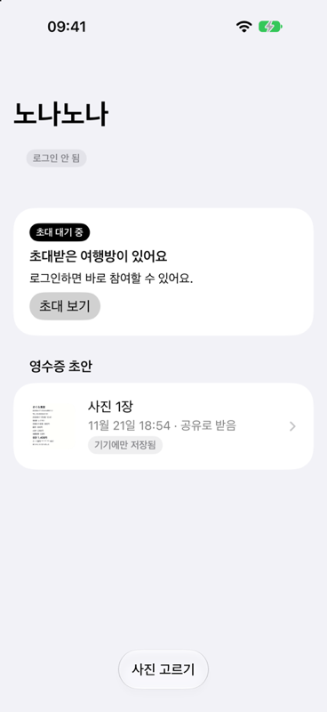
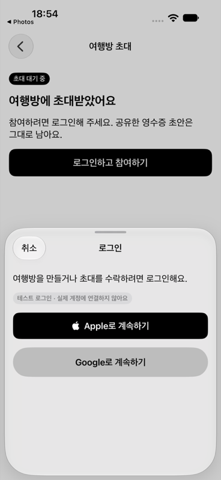
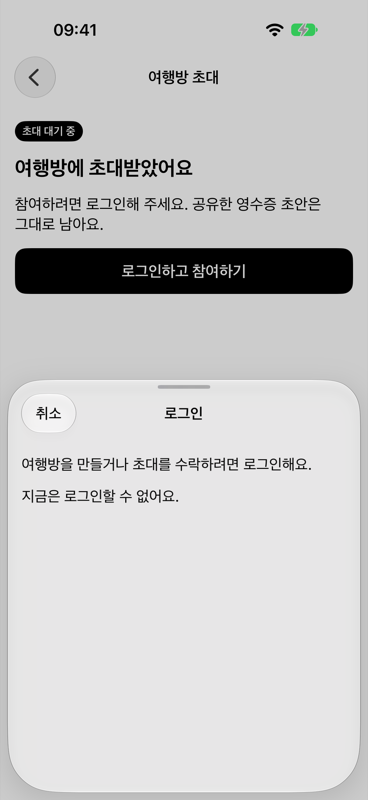
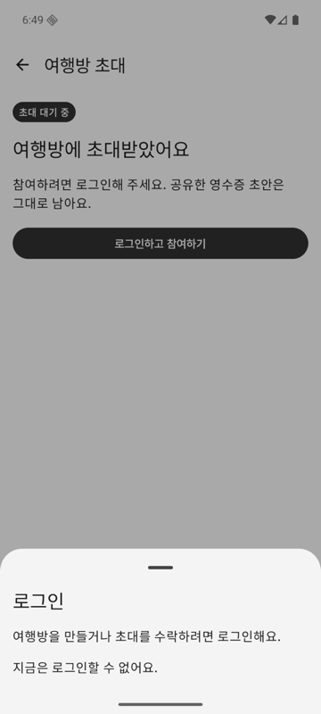

# 모바일 디자인 기준

iOS(SwiftUI)와 Android(Compose)를 따로 만들면서 두 앱이 같은 서비스로 보이게 하는 최소 기준이다. 두 앱은 같은 **역할 이름, 문구, 화면 상태**를 쓰고, 생김새는 각 플랫폼의 시스템 스타일을 따른다. 공유 UI 코드, 토큰 생성기, Figma, 디자인 시스템 라이브러리는 두지 않는다. 브랜드 색은 아직 정하지 않았다. 아래 값은 모두 임시이며 각 플랫폼의 테마 파일 하나에서 바꾼다.

| 플랫폼 | 역할을 연결한 파일 |
| --- | --- |
| iOS | `apps/ios/Nonanona/Design/Theme.swift` |
| Android | `apps/android/app/src/main/java/app/nonanona/design/Theme.kt`, `StatusLabel.kt` |

## 맞추는 것과 플랫폼에 맡기는 것

| 맞춘다 | 플랫폼에 맡긴다 |
| --- | --- |
| 역할 이름(색·글자·간격·상태 라벨) | 탐색: iOS `NavigationStack`, Android Navigation 3 + 시스템 뒤로 가기(예측 뒤로 포함) |
| 한국어 문구와 말투(해요체, 짧은 문장) | 시트: iOS `.sheet`(detents), Android `ModalBottomSheet` |
| 화면과 상태의 종류, 상태를 바꾸는 동작 | 사진 고르기: iOS `PhotosPicker`, Android 시스템 사진 선택기(`PickMultipleVisualMedia`), 둘 다 권한 요청 없음 |
| 상태는 글자 라벨로 표시(색은 보조) | 공유로 받기: iOS 공유 확장(시트 안에서 "초안에 담기"), Android 공유 대상 Activity(바로 담고 스낵바) |
| 간격 값 | 제목: iOS 큰 제목, Android 상단 앱 바 / 주 동작: iOS 하단 막대, Android 확장 FAB |
| 글자 크기는 시스템 설정을 따름 | 로그인 버튼 모양(아래 "로그인 버튼") |

## 색 역할 (임시 중립 팔레트)

브랜드 색이 없으므로 무채색만 쓴다. Android는 동적 색(Material You)을 끈다. 두 앱의 화면을 같은 기준으로 비교하기 위해서다.

| 역할 | 뜻 | SwiftUI | Compose Material 3 |
| --- | --- | --- | --- |
| background | 화면 바탕 | 시스템 그룹 배경(목록 기본값) | `background`/`surface` 라이트 #F9F9F9, 다크 #131313 |
| container | 카드·목록 행 | 목록 셀 배경 | `surfaceContainerHigh` |
| content | 본문 글자 | `.primary` | `onSurface` |
| contentSecondary | 보조 글자 | `.secondary` | `onSurfaceVariant` |
| accent | 주 동작·강조, 앱 tint | `.primary`(라이트 검정, 다크 흰색) | `primary` 라이트 #303030, 다크 #E2E2E2 |
| onAccent | accent 위 글자 | `systemBackground` | `onPrimary` |
| error | 실패 문구 | `.red` | `error`(M3 기본값) |

## 글자 역할

크기를 직접 정하지 않는다. iOS는 Dynamic Type 텍스트 스타일, Android는 M3 기본 타입 스케일(sp)을 써서 시스템 글자 크기 설정을 그대로 따른다.

| 역할 | 쓰는 곳 | SwiftUI | Compose M3 |
| --- | --- | --- | --- |
| screenTitle | 화면 제목 | 내비게이션 큰 제목 / inline | `TopAppBar` 제목 |
| heading | 화면 안 큰 문장(초대 화면) | `.title2.bold()` | `headlineSmall` |
| sectionTitle | 섹션 머리말, 카드 제목 | `.headline` | `titleMedium` |
| body | 본문 | `.body` | `bodyLarge` |
| supporting | 설명·날짜 | `.subheadline` | `bodyMedium` |
| status | 상태 라벨 | `.caption.weight(.semibold)` | `labelMedium` |

한국어 줄바꿈: iOS는 기본으로 어절 단위로 끊는다. Android는 글자 로캘을 `ko-KR`로 두고 `LineBreak.WordBreak.Phrase`를 써서 같은 결과를 낸다(API 33 이상).

## 간격 역할

`xs 4`, `s 8`, `m 16`(화면 좌우 여백, 카드 안 여백), `l 24`, `xl 32`. 단위는 pt와 dp로 같은 숫자다. 목록 행 높이와 안쪽 여백은 시스템 목록 기본값을 따른다.

## 상태 라벨

상태는 항상 글자로 보여 준다. 색만으로 구분하지 않는다.

| 역할 | 예 | SwiftUI | Compose M3 |
| --- | --- | --- | --- |
| neutral | 기기에만 저장됨, 로그인 안 됨, 방장, 나 | `.secondary` / `tertiarySystemFill` | `onSurfaceVariant` / `surfaceContainerHighest` |
| attention | 초대 대기 중 | `systemBackground` / `.primary`(반전) | `onPrimary` / `primary` |
| positive | 로그인됨 · 이름, 참여함 | `.primary` / `secondarySystemFill` | `onSecondaryContainer` / `secondaryContainer` |
| error | (실패 상태 라벨용 예약) | `.red` / 옅은 빨강 | `onErrorContainer` / `errorContainer` |

## 화면과 상태

| 화면 | 상태 | 주요 문구 |
| --- | --- | --- |
| 홈 | 초안 없음 / 초안 있음 / 초대 대기 카드 / 로그인 안 됨·로그인됨 | 노나노나 · 영수증 초안 · 아직 초안이 없어요 · 사진 N장 · 기기에만 저장됨 · 사진 고르기 |
| 공유로 받기 | 담기 전 / 담는 중 / 실패 | 영수증 초안에 담기 · 사진 N장을 이 기기의 초안에 저장해요. 로그인하지 않아도 돼요. · 사진 N장을 초안에 담았어요 |
| 초안 | 사진 목록 | 초안 · 로그인하지 않아도 이 기기에 보관돼요. |
| 초대 | 로그인 필요 / 참여 가능 / 참여 중 / 실패 | 여행방 초대 · 여행방에 초대받았어요 · 로그인하고 참여하기 · 참여하기 · 참여하지 못했어요. 다시 시도해 주세요. |
| 로그인 시트 | 고르기 / 로그인 중 / 실패 / 사용 불가 | 로그인 · 여행방을 만들거나 초대를 수락하려면 로그인해요. · 지금은 로그인할 수 없어요. |
| 여행방 | 참여함 | 일행 · 방장 · 나 · 영수증 초안 N장은 아직 이 기기에만 있어요. |

debug 빌드의 테스트 로그인은 시트에 **테스트 로그인 · 실제 계정에 연결하지 않아요** 라벨을 붙인다. 이 문구와 테스트 구현체는 release 빌드에 들어가지 않는다.

## 로그인 버튼

- iOS: Apple(검정 바탕 흰 글자, 다크에서는 반전, Apple 로고 SF Symbol)과 Google(테두리 버튼). Android: Google만(테두리 버튼). [ADR-0002](../adr/0002-authentication-and-device-transfer.md)의 제공자 구성이다.
- 실제 로그인을 연결할 때 iOS는 `SignInWithAppleButton`, Google은 브랜드 지침의 공식 버튼(로고 포함)으로 바꾼다. 지금 버튼은 같은 자리와 문구만 맞춘 임시 버튼이다.

## 확인한 것 (2026-11-21, 가상 자료)

핵심 화면은 **로그인 전 홈(초안 1장 + 초대 대기)**이다. 아래 화면은 두 앱의 E2E 실행 중 같은 상태에서 찍었다(iPhone 18 Pro 시뮬레이터 iOS 27.2, Android 에뮬레이터 API 36).

| | iOS | Android |
| --- | --- | --- |
| 라이트 |  |  |
| 다크 |  |  |
| 큰 글자 |  |  |
| 로그인 시트(debug) |  |  |
| 로그인 시트(release) |  |  |
| 여행방 |  |  |

- 다크: 모든 글자·라벨이 바탕과 구분된다. 초대 대기 라벨은 반전 색, 주 동작은 라이트에서 검정, 다크에서 흰색이다. 하드코딩한 흰색·검정 글자는 없다.
- 큰 글자(iOS `accessibility-large`, Android `font_scale 2.0`): 글자가 잘리거나 겹치지 않고 줄이 늘어난다. 처음에 Android 초안 행의 상태 라벨을 행 끝에 두었더니 날짜가 좁은 칸에서 음절 단위로 끊겨, 라벨을 날짜 아래로 옮겨 iOS와 같은 배치로 맞췄다. 한국어 어절 줄바꿈도 이때 고쳤다.
- Android는 다크 전환과 글자 크기 변경(설정 변경으로 Activity를 다시 만듦) 뒤에도 같은 화면과 상태가 남는 것을 E2E에서 확인했다.
- 확인하지 않은 것: VoiceOver/TalkBack 읽기 순서, 명암비 수치 측정, 가로 화면, 태블릿, 오른쪽에서 왼쪽 언어.

## 참고한 플랫폼 문서

- Apple HIG: [Typography](https://developer.apple.com/design/human-interface-guidelines/typography), [Color](https://developer.apple.com/design/human-interface-guidelines/color), [Dark Mode](https://developer.apple.com/design/human-interface-guidelines/dark-mode), [Sheets](https://developer.apple.com/design/human-interface-guidelines/sheets), [Sign in with Apple](https://developer.apple.com/design/human-interface-guidelines/sign-in-with-apple)
- Material 3: [Color roles](https://m3.material.io/styles/color/roles), [Typography](https://m3.material.io/styles/typography/applying-type), [Bottom sheets](https://m3.material.io/components/bottom-sheets/guidelines)
- Android: [Photo picker](https://developer.android.com/training/data-storage/shared/photopicker), [Receive data from other apps](https://developer.android.com/training/sharing/receive), [Font scaling](https://developer.android.com/guide/topics/resources/runtime-changes)
- Google: [Sign in with Google branding guidelines](https://developers.google.com/identity/branding-guidelines)
